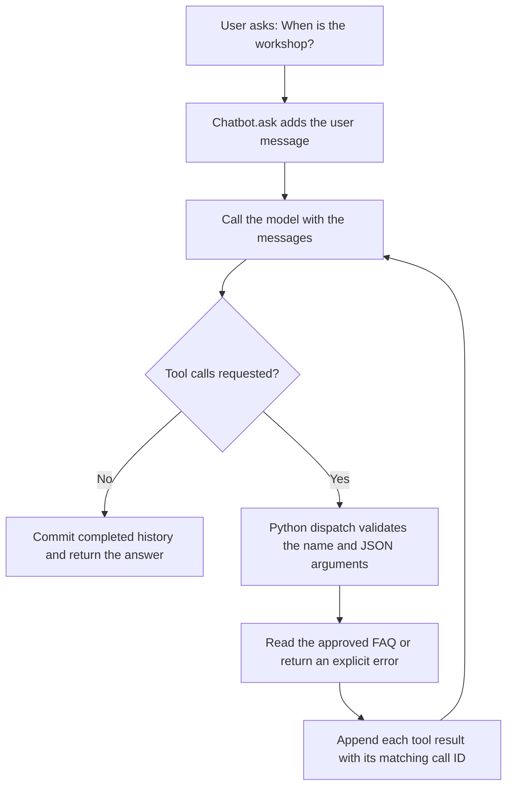

# Understand one tool-using chatbot turn

This is a teaching map of the code in `src/agent.py`, not a product architecture or deployment plan. Read it alongside A1–A5 in the chatbot notebook.

## The main idea

The model proposes a tool call. The Python application validates and executes it. The tool result goes back into the messages, and another model round can produce the final answer.

`Chatbot.ask` permits four model rounds by default. If no final answer arrives within that limit, it raises an error instead of looping forever. A model response can request multiple tools; each gets a result before the next round.

## Follow the example

| Step | What happens | Who does the work? |
|---|---|---|
| 1 | Ask "When is the workshop?" | User |
| 2 | Propose `lookup_faq` with `{"topic":"schedule"}` | Model function |
| 3 | Validate the tool name, parsed JSON shape, and approved topic | Python dispatcher |
| 4 | Read the schedule and append a result linked by `tool_call_id` | Python application |
| 5 | Use the result to produce the answer | Another model round |

The two assistant messages have different jobs: first request work, then answer using the result.

## Offline versus live

The default `offline_model` uses keyword rules and a special "when" rule. It does not run a language model or understand arbitrary paraphrases. `live_model` optionally calls a hosted model API. Both use the same message loop and Python dispatcher.

The dictionary is an approved data source, not a search engine. The schema describes permitted inputs, but Python must still validate them. A tool result is data, not permission to execute arbitrary instructions.

## What changes in the contact exercise?

You add one key and value to `FAQ`. On a fresh import, the topic schema derives from the dictionary keys, and the keyword matcher sees the new topic. Save, restart the kernel, rerun A1–A4, and enable the A4b check. No model weights are changed.

## Questions to explain to a partner

1. Why are there two assistant messages in a simple tool-using turn?
2. What connects a tool result to its request?
3. What happens when the tool name or topic is invalid?
4. Why is saved conversation history not the same as model training?
5. Why does the loop need a stopping rule even when all requested tools are valid?
