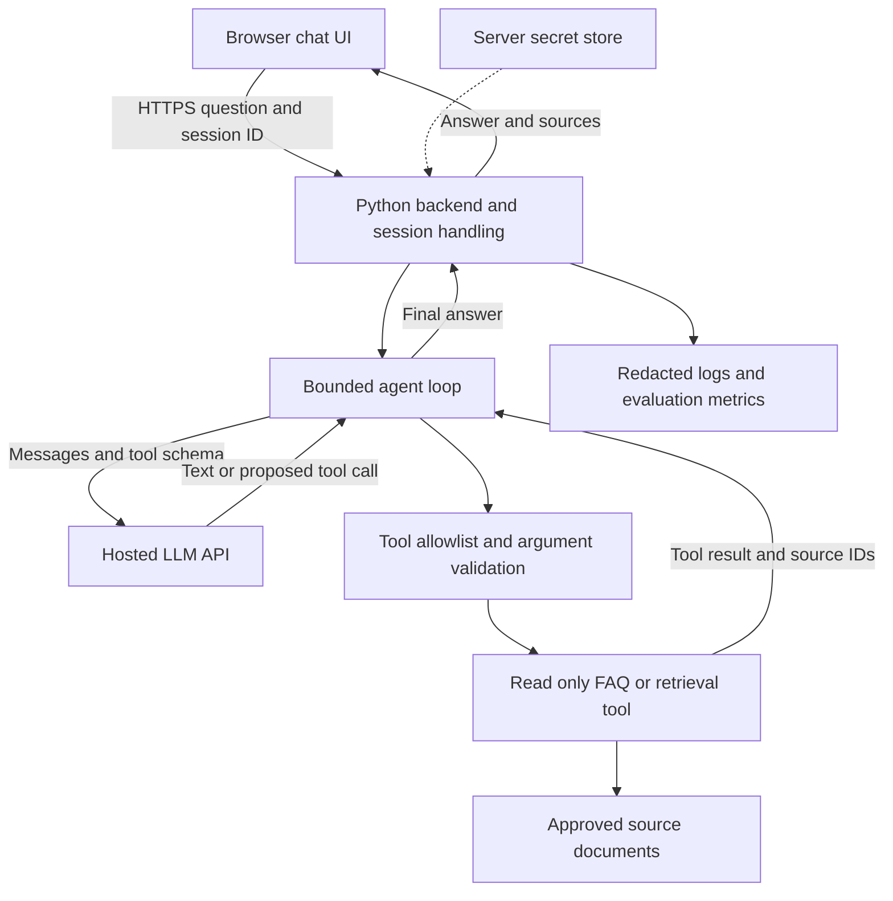

# Chindi Chat Agent architecture

This is a proposed reference architecture for a beginner project. Today’s runnable prototype uses a fixed FAQ dictionary. Retrieval, a web UI, and hosted deployment are implementation milestones, not features already present in the notebook.

## Assumptions to confirm

ASSUMPTION A1: Chindi Chat Agent is a text chatbot answering questions from an approved FAQ or document collection. The name alone does not establish its domain or languages.

ASSUMPTION A2: The first pilot serves a small group of interns, with read-only tools. It does not send messages, accept payments, or change business records.

ASSUMPTION A3: Internet access and a hosted LLM API are allowed. Confirm provider, region, budget, data handling, and model access before using real documents.

ASSUMPTION A4: English is sufficient for the first prototype. Confirm whether Hindi, Marathi, or other languages are required. Do not assume multilingual quality from a model name.

ASSUMPTION A5: Conversations need only in-memory storage for the workshop. Confirm retention, authentication, and access requirements for a pilot.

## Proposed component diagram

The tool result returns to the model through the next agent-loop API request. Diagram arrows show data flow, not a separate direct connection from the tool to the provider. Today’s dictionary implements the read-only FAQ component. The notebook has no browser, HTTP server, authentication, retrieval index, or secret store.

## Component responsibilities

The browser collects questions and shows answers. It never receives the API credential. The backend validates request size, authenticates pilot users, separates sessions, and owns conversation lifetime. The agent loop sends context and schemas, executes approved tool calls, and stops on a final answer or round limit. The LLM proposes text and tool calls but does not directly execute Python.

The tool dispatcher validates function names and inputs. A future retrieval tool searches only approved sources that the current user may access and returns short snippets plus document identifiers. Document ingestion should preserve title, version, and access labels. Retrieved text is untrusted data and cannot grant permissions. The final answer should cite sources or say when the available documents do not answer the question. Source citations still need evaluation for correctness.

A secret store supplies credentials to the server. Monitoring records request IDs, duration, error type, token usage, and tool success without storing secrets or unnecessary personal data. Cost controls should cap input length, model rounds, output tokens, request rate, and daily usage. The classroom code only implements some of these controls.

## Deployment options

| Option | Best use | What to add | Tradeoff |
|---|---|---|---|
| Local Jupyter notebook | Workshop and debugging | Virtual environment | Not a shared service |
| Local Streamlit interface | Small UI prototype | Per-session Chatbot object and local secrets | Local process must remain running |
| Managed web hosting such as Azure App Service | Small pilot | Python HTTP backend, authentication, server secrets, session isolation, health checks | Hosting and API charges; configuration work |
| Container on managed hosting | Repeatable team deployment | Container build, registry, deployment configuration, external session storage if scaled | More infrastructure for beginners |

Recommendation: notebook first, then a small managed web pilot after requirements are confirmed. Confirm current hosting support, pricing, and regional constraints during implementation. A deployment option is not a completed deployment.

## Suggested milestones and acceptance checks

M1 • Requirements, half day: identify audience, languages, allowed documents, data permissions, provider, budget, and pilot owner. Acceptance: one-page agreed scope and ten representative questions with reviewed answers.

M2 • Offline prototype, half day: run the supplied chatbot and add one FAQ topic. Acceptance: valid calls, unknown tools, malformed JSON, unsupported topics, and loop limit tests pass.

M3 • Live API integration, half to one day: select a tool-capable model and configure server credentials. Acceptance: reviewed questions produce correct tool use, authentication failures do not leak secrets, and request limits apply. Live behavior is nondeterministic, so evaluate facts and tool use rather than exact wording.

M4 • Approved retrieval, one to two days: ingest a small versioned document set and return snippets with source IDs. Acceptance: answers cite the right sources, unsupported questions receive an appropriate uncertainty response, and unauthorized documents never appear.

M5 • Authenticated pilot, one to two days: add a web interface and backend, isolate sessions, configure hosting and logging. Acceptance: two users cannot see each other’s history, secrets stay on the server, errors are actionable, and the owner can inspect latency and usage.

M6 • Evaluation and iteration, ongoing: expand the reviewed question set to cover ambiguity, out-of-scope questions, and hostile instructions in documents. Set a correctness threshold with the project owner before release. Estimates are teaching suggestions, not delivery commitments.

## Decisions before real deployment

Who uses Chindi, and what problem does it solve? Which languages and documents matter? May the service store conversations? Which region and identity system should it use? Who reviews incorrect answers? Which actions, if any, need human approval? Confirm these before choosing production components.
